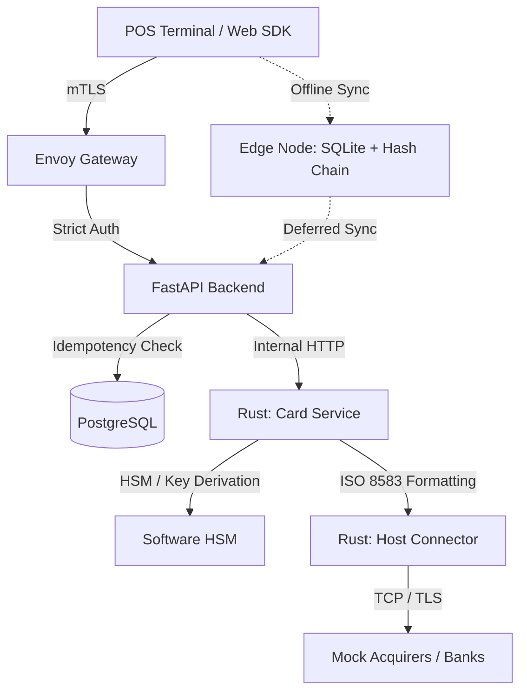

<div align="center">

# ⚡ Synapse Pay

**A multi-acquirer payment orchestration engine with offline-first edge capabilities.**

[](https://www.rust-lang.org/)
[](https://www.python.org/)
[](https://www.postgresql.org/)
[](https://www.envoyproxy.io/)

[Architecture](#️-architecture) • [Core Features](#-core-features) • [Quick Start](#-quick-start) • [Documentation](#-documentation)

</div>

---

## 📖 Overview

Synapse Pay is a **production-grade payment orchestration engine** — a reference implementation that shows how the hard parts of card payments actually work:

- **ISO 8583 over mTLS** — a Rust host-connector formats and signs real acquiring messages; a software HSM derives per-card keys via HKDF/AES-GCM.
- **Idempotent cascade routing** — if psp_1 times out, the engine queues a durable reversal before failing over to psp_2, so the customer is never double-charged.
- **Offline-first edge nodes** — POS terminals keep processing during ISP outages; rules are signed by the cloud, local transactions are hash-chained, and sync is idempotent on reconnect.
- **Hash-chained audit log** — every payment state change is chained and written to append-only WORM storage; a verifier detects any tampering or gap.

The architecture is multi-language by design: **Python (FastAPI)** for orchestration and merchant APIs, **Rust** for the cryptographic core and ISO 8583 parsing, and **Envoy** for zero-trust mTLS at the perimeter. It is a sandbox — all acquirers, banks, and the HSM are simulated — but the patterns, the failure handling, and the code are the real thing.

> **Status:** sandbox only. All acquirers, banks and the HSM are simulated.

## 🏗️ Architecture

Synapse Pay is designed with a **zero-trust** perimeter and a strict separation of concerns.



### 🦀 Why Multi-Language?
*   **Python (FastAPI):** Chosen for the orchestration layer, rapid API development, and complex routing logic. Handles idempotency, merchant state, and webhook fan-out.
*   **Rust (Card Service & Host Connector):** Chosen for the cryptographic core. Rust ensures memory safety while parsing untrusted binary data, deriving HSM keys (HKDF/AES-GCM), and encoding strict ISO 8583 messages.
*   **Envoy Proxy:** Terminates mTLS for terminals, enforcing certificate revocation and terminal identity pinning before requests ever touch the application layer.

## ✨ Core Features

*   **🔒 Zero-Trust mTLS Perimeter:** Terminals authenticate via mutual TLS. Envoy validates certificates against a registry and injects identity headers, dropping any spoofed copies from outside.
*   **⏱️ Idempotency:** A Postgres-backed locking mechanism (`idempotency_keys`) prevents double-charging on network retries. Handles in-flight requests, hard declines, and soft declines safely.
*   **📴 Offline-First Edge Nodes:** Terminals can process payments locally during ISP outages. Rules are cryptographically signed by the cloud. Local transactions are hash-chained to prevent tampering, then synced idempotently.
*   **🔄 Smart Reversals:** If an acquirer times out, the system does *not* blindly retry on another host (avoiding double charges). It queues a durable reversal to cancel the first request.
*   **📊 Observability:** Prometheus metrics, OpenTelemetry tracing, and a hash-chained audit log for compliance.
*   **🪪 Merchant KYC:** PAN + GST submission with PENDING / APPROVED / REJECTED lifecycle; live key generation is gated on approval.
*   **🛡️ Fraud Velocity Check:** IP-based rate limiting blocks IPs with 5+ failed payment attempts in 60 seconds (`FRAUD_DETECTED`, HTTP 429).
*   **💳 Transparent Settlements:** itemized breakdown of gross, MDR (0%), GST, and net for every settlement batch.
*   **📋 Subscription Engine:** merchants subscribe to a plan to unlock 0% MDR, offline edge entitlement, and live-mode keys.

## 🚀 Quick Start

Run the sandbox locally: it applies the database migrations, builds the Rust card service and starts the API.

### Prerequisites
*   Docker & Docker Compose (for PostgreSQL), or a local PostgreSQL
*   Rust (`cargo`)
*   Python 3.12+

### Installation

```bash
# 1. Clone the repository
git clone https://github.com/abdulbaseer53078-wq/synapse-pay.git
cd synapse-pay

# 2. Start PostgreSQL
docker compose up -d db

# 3. Start the sandbox (applies migrations, builds the card service, prints test API keys)
cd backend
pip install -r requirements.txt
python -m app.sandbox
```

The API is now live at `http://localhost:8000`. Explore the interactive Swagger UI at `http://localhost:8000/docs`, or [take a test payment in 5 minutes](docs/quickstart.md).

## 🧪 Testing

The codebase includes property-based tests for the ISO 8583 parser and an API contract test suite.

```bash
# Python backend tests
pytest backend/tests

# Rust tests (Card Service & ISO parser)
cargo test --manifest-path card-service/Cargo.toml
cargo test --manifest-path iso8583/Cargo.toml

# Edge node tests (offline engine, signed rules, sync)
pytest edge-node/tests

# API contract tests
./spec/contract-test.sh
```

## 📚 Documentation

*   [**Launch Guide**](docs/launch-guide.md) — run `run_dev.ps1`, log in, process a test payment end-to-end.

Deep-dive into the architecture and design decisions:
*   [API Contract & Idempotency](docs/understanding/01-api-contract.md)
*   [Backend Transaction Flow](docs/understanding/02-backend-transaction-flow.md)
*   [Rust Card Service & HSM](docs/understanding/03-rust-card-service.md)
*   [Host Connector](docs/understanding/04-host-connector.md)
*   [Gateway & mTLS Security](docs/understanding/05-gateway-security.md)
*   [Offline Edge Architecture](docs/understanding/06-edge-node.md)

## 🛡️ Security Posture

Synapse Pay is designed with PCI-DSS in mind (not certified).
*   **No raw PANs** are stored in the primary database (tokenization required).
*   **The public test BDK** (Base Derivation Key) is refused at startup outside the sandbox.
*   **Envoy** drops any external traffic attempting to forge internal identity headers (`x-terminal-id`).
