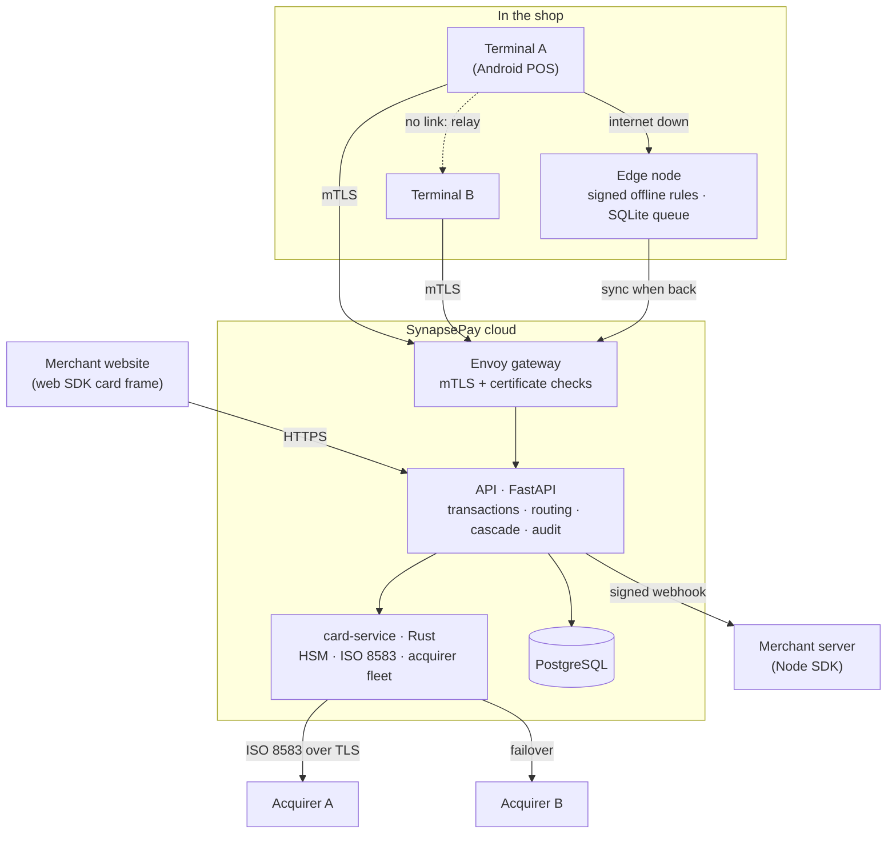

# SynapsePay

**An open payment network you can read end to end: from the card tap on a terminal, through ISO 8583 to the
acquirer, to the signed webhook, with every hard problem in between built and tested.**

Cards, UPI, wallets, QR and offline payments all go through one API contract. Terminals talk straight to the
cloud over mutual TLS. When a shop's internet drops, an on-premise edge node keeps it taking payments, and a
terminal with no link at all can relay through the terminal next to it.

> **Status:** a working sandbox, not a production processor. The HSM, acquirers, PSPs and card schemes are
> simulated, so you can run the whole network on a laptop and take a test payment in five minutes.


---

## Why you might find this interesting

Most payment code is closed source, so the hard parts are rarely explained. Here they're built, tested, and
written down next to the code:

| Problem | How it's solved here | Where |
| :--- | :--- | :--- |
| **Never charge a card twice** when the network fails mid-payment | Mandatory idempotency keys; a timed-out acquirer is never retried on another one, because it may already have approved | [`card-service/src/fleet.rs`](card-service/src/fleet.rs), [`backend/app/application/routing.py`](backend/app/application/routing.py) |
| **Speak ISO 8583**, the 1980s binary protocol banks still run on | A dictionary-driven parser and packer with property tests | [`iso8583/`](iso8583/) |
| **Keep card numbers out of everything** | Cards are encrypted on the terminal or in the browser, and only one Rust process with the (simulated) HSM can decrypt them | [`card-service/src/hsm.rs`](card-service/src/hsm.rs) |
| **Fail over between acquirers** in the middle of a payment | A cascade engine routes on error categories (soft decline, hard decline, system error) | [`backend/app/application/routing.py`](backend/app/application/routing.py) |
| **Keep selling with the internet down** | An edge node enforces signed offline rules, signs each sale, queues it in SQLite and syncs it later | [`edge-node/`](edge-node/) |
| **A terminal with no link at all** | It tunnels its own mutual-TLS session through a neighbouring terminal, which can't read or change it | [`sdks/terminal-transport/`](sdks/terminal-transport/) |
| **Prove the audit log wasn't edited** | A hash-chained, append-only audit log backed by S3 Object Lock | [`backend/app/audit/`](backend/app/audit/), [`docs/step7.md`](docs/step7.md) |
| **Survive a whole cloud region going down** | Active-passive across two Indian AWS regions, with a game-day driver | [`docs/step17.md`](docs/step17.md), [`infra/`](infra/) |
| **See every failover** | One `FAILOVER_TRIGGERED` event across Python, Rust and the SDK, a single trace id end to end, plus Prometheus alerts | [`observability/`](observability/) |

Every one of these has a test that breaks if the guarantee breaks: chaos tests that cut cables mid-payment, tests
that edit a queued sale, and tests that replay old signed rules.

## Architecture



The rule that holds it together: **providers are plugins**. Each rail (card, UPI, wallet, QR, offline) is an
adapter behind one interface, so adding a payment method means writing an adapter, not changing the engine.

## Try it in 5 minutes

You need PostgreSQL (user `postgres`, password `postgres`), Python 3.12+, Rust and Node.js 18+.

```bash
# 1. The sandbox: API, card service, simulated bank. It prints a secret key and a webhook secret.
cd backend
pip install -r requirements.txt
python -m app.sandbox

# 2. In a second terminal: an example shop
cd examples/node-shop
npm install
SYNAPSE_SECRET_KEY=sk_test_... SYNAPSE_WEBHOOK_SECRET=whsec_... npm start
```

Open http://localhost:3000 and pay with `4111 1111 1111 1111` (any future expiry and CVV). Enter OTP `123456`
when the sandbox bank asks. Full walkthrough and test cards: [`docs/quickstart.md`](docs/quickstart.md).

## One contract for every payment method

Everything is in [`spec/openapi.yaml`](spec/openapi.yaml) (OpenAPI 3.1, v1 frozen, additive changes only).

```json
POST /api/v1/transactions
{
  "idempotency_key": "6f1c…",
  "amount": 49999,
  "currency": "INR",
  "payment_method": "UPI",
  "method_details": { "vpa": "asha@okhdfcbank", "flow_type": "COLLECT" },
  "terminal_id": "…",
  "merchant_id": "…"
}
```

- **Same top level, method-specific `method_details`.** Swap `"UPI"` for `"CARD"` and send card details instead.
- **Integer amounts in the smallest unit.** ₹499.99 is `49999`. Never a float.
- **Idempotency is mandatory.** Replaying a key returns the original answer; reusing it with a different body is `409`.
- **Errors are built for routing.** Every error has an `error_category` and a `retryable` flag, and the cascade
  engine decides from those whether to try another acquirer.
- **Capabilities are declared.** `GET /api/v1/capabilities/{method}` says what a rail supports: refunds,
  chargebacks, settlement time and its allowed state transitions.

| Method | Authorization | Settlement | Disputes |
| :--- | :--- | :--- | :--- |
| CARD | Issuer, over ISO 8583 | T+1 | Card scheme |
| UPI | VPA collect | Instant | NPCI |
| WALLET | OTP | T+0 | None |
| QR | Same as the rail it encodes | Same | Same |
| OFFLINE | Local rules on the edge node | On sync | None in v1 |

## What's in the repo

```text
synapse-pay/
├── spec/                # The API contract (OpenAPI) and its contract tests
├── backend/             # FastAPI: transactions, routing and cascade, terminal registry, audit log (Python)
├── card-service/        # Simulated HSM, card flow and acquirer fleet: the only process that sees a card number (Rust)
├── iso8583/             # ISO 8583 parser and packer (Rust)
├── host-connector/      # Acquirer links: mTLS, connection pool, echo, reversals, mock acquirer (Rust)
├── gateway/             # Envoy: terminal mTLS and certificate checks before the backend
├── edge-node/           # On-premise offline engine and sync worker (Python, SQLite)
├── sdks/
│   ├── node/            # Merchant server SDK (TypeScript)
│   ├── web/             # Browser card frame SDK (TypeScript)
│   ├── terminal-transport/  # Multi-path networking and the terminal mesh (Java 8, no dependencies)
│   ├── android/  flutter/   # Mobile SDKs
├── examples/node-shop/  # A complete shop in one file
├── observability/       # Prometheus alerts (with promtool tests) and a Grafana failover dashboard
├── infra/               # Terraform: two-region ECS, Route 53 failover, audit WORM bucket
├── db/migrations/       # PostgreSQL schema
└── docs/                # How each part works and why it was built that way
```

## Running the tests

```bash
cd backend && pytest                      # API, routing, audit, edge sync (needs PostgreSQL)
cd card-service && cargo test             # HSM, card flow, failover
cd iso8583 && cargo test
cd sdks/terminal-transport && ./run-tests.sh   # cable-pull chaos tests and the mesh
cd edge-node && pytest
bash spec/contract-test.sh                # the contract against a mock server
```

## Where it's going

| Area | Status |
| :--- | :--- |
| Unified contract, terminal registry, mTLS gateway | ✅ |
| ISO 8583, acquirer connector, card service | ✅ |
| Payment intents, web and Node SDKs, signed webhooks | ✅ |
| Hash-chained audit log | ✅ |
| Card, UPI, QR and wallet adapters | ✅ (wallet redirect flow pending) |
| Multi-acquirer routing and cascade, chaos-tested | ✅ |
| Terminal multi-path networking, region failover, observability | ✅ |
| Edge node: signed rules, offline engine, sync | ✅ |
| Terminal mesh relay | ✅ (BLE and Wi-Fi Direct adapters need real devices) |
| Certification registry, token vault, local fraud screening | 🚧 in progress |
| Terminal app on real POS hardware | ⏳ |

## Contributing

Issues and pull requests are welcome. Good places to start:

- Read a design doc in [`docs/`](docs/) and the code beside it. Each step explains its trade-offs.
- Run the sandbox and try to break it. Bug reports with a failing test are the most useful kind.
- The open items in the table above are real work waiting for someone.

Conventions: providers stay behind interfaces, every money-moving endpoint is idempotent, and no card number,
token or personal data ever reaches a log.
